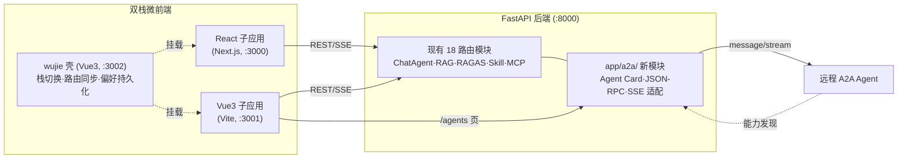

# PRism 重构技术方案（A2A 后端 + React/Vue 双栈微前端）

> 状态：**待审批** — 本文档仅为方案，未经批准不改动任何代码。
> 项目落点：`f:\面试\PRism`（git 已初始化，初始提交 `9992f05`）
> 原则：功能纯增量，不大幅删除现有技术；验证以构建/lint/静态检查为准，不做真机端到端测试。

---

## 一、总体蓝图



大工作块：

1. **更名与落位**：全局 DevFlow AI → PRism AI
2. **A2A 后端**（纯增量）：把现有 Agent 以 A2A 协议对外发布，并让 ChatAgent 可调用远程 A2A Agent
3. **双栈微前端**：React 版仅 3 处最小改动，新建 Vue 3 全量对等版 + wujie 壳

---

## 二、Phase N0：更名 PRism（先做，一次提交）

项目已迁至 `f:\面试\PRism`，需完成命名统一（项目未产生持久数据，现在改动零成本）：

| 类别       | 文件                                 | 改动                                                                                                 |
| ---------- | ------------------------------------ | ---------------------------------------------------------------------------------------------------- |
| 后端应用名 | `backend/app/core/config.py`       | `app_name: "DevFlow AI"` → `"PRism AI"`                                                         |
| 环境变量   | `.env.example`                     | `APP_NAME=PRism AI`；`PROMPT_CACHE_KEY=prism-agent-v1`；`MILVUS_COLLECTION=prism_rag_qwen1024` |
| 容器与卷   | `docker-compose.yml`               | `container_name: prism-*`，卷名 `prism_*`（本地未跑过 Docker，安全）                             |
| 数据库     | `.env.example`                     | `DATABASE_URL` 中库/用户 `devflow` → `prism`；`scripts/init_pgvector.sql` 注释同步          |
| 前端包名   | `frontend/package.json`            | `devflow-ai-frontend` → `prism-react`                                                           |
| 页面标题   | `frontend/app/layout.tsx` metadata | `DevFlow AI` → `PRism AI`                                                                       |
| README     | `README.md`                        | 全文更名 + 新增双栈架构与 A2A 章节（占位，后续阶段回填）                                             |
| 文档       | `docs/` 内出现 DevFlow 字样的文件  | 同步更名                                                                                             |

**不动**：Python 包路径 `backend/app/...`、表名、API 路径 `/api/*`（避免大面积代码改动）；如需彻底改包名另行评估。

---

## 三、Phase N1：A2A 协议后端（纯增量，零删除）

### 3.1 依赖与配置

- 新增依赖：`a2a-sdk`（锁定版本，按安装版本对应的 spec 实现；要求 Python ≥3.10）
- `.env` 新增 4 项：`A2A_ENABLED`、`A2A_PUBLIC_BASE_URL`、`A2A_REMOTE_AGENT_URLS`（逗号分隔远程端点）、`A2A_TIMEOUT_SECONDS`

### 3.2 新模块 `backend/app/a2a/`

| 文件               | 职责                                                                                                                                                                                                                       |
| ------------------ | -------------------------------------------------------------------------------------------------------------------------------------------------------------------------------------------------------------------------- |
| `agent_card.py`  | 构建 Agent Card：声明两个 Agent——`prism_chat`（ChatAgent）与 `prism_review`（WorkflowOrchestrator），含 skills/description/流式能力声明；暴露于 `/a2a/.well-known/agent-card.json`                                 |
| `skills.py`      | 把现有 Agent 包装为 A2A Skill：入参 message/context → `ChatAgent.run_stream` / `WorkflowOrchestrator` 执行；产物 = `AnalysisResult` + citations                                                                     |
| `server.py`      | `A2AStarletteApplication` 挂载到 FastAPI `/a2a`（FastAPI 基于 Starlette，原生兼容）：JSON-RPC `message/send`、`message/stream`(SSE)、`tasks/get`、`tasks/cancel`                                               |
| `sse_adapter.py` | **核心适配层**：现有 `run_stream` 事件（delta/tool_use/tool_result/final）→ A2A `TaskStatusUpdateEvent`；Task id/context id 关联与生命周期状态机（submitted→working→completed/failed）；citations → Artifact |

### 3.3 接入点（均为增量）

1. **客户端工具 ×2**：`a2a.discover_agents`（拉取远程 Agent Card）、`a2a.invoke_agent`（调用远程 Agent）注册进 ChatAgent 现有工具表（`app/api/routes/chat.py` 工具组装处）——对工具调用循环零改动，只是多两个工具
2. **工作流远程执行**：`workflow_orchestrator._run_task_graph` 增加可选分支——任务 spec 声明 `executor: "a2a://<url>"` 时走远程 Agent，Observer/Synthesis 不动
3. **main.py**：`A2A_ENABLED=true` 时挂载 `/a2a` 路由（一个 if 分支）

### 3.4 测试（新增，不动现有测试）

- `tests/test_a2a_agent_card.py`：Card 结构与 skills 声明
- `tests/test_a2a_stream_adapter.py`：run_stream 事件 → A2A 事件映射（含 final→completed、异常→failed）
- `tests/test_a2a_tools.py`：discover/invoke 工具的 mock 调用
- 验证命令：`pytest tests/test_a2a_*.py` + 全量 `pytest` 回归 + `uvicorn` 可启动静态检查

---

## 四、Phase F0–F8：双栈微前端

### 4.1 目录与端口（新增两个工程，React 版仅 3 处改动）

```
f:\面试\PRism\
├── frontend\          # React 子应用（栈 react，:3000）—— 仅 3 处最小改动
├── frontend-vue\      # 新建 Vue3 子应用（栈 vue，:3001）
├── frontend-shell\    # 新建 wujie 壳（Vue3，:3002）
└── scripts\
    ├── check-lib-parity.mjs   # 双栈 lib 漂移检查（hash 对比）
    └── build-www.mjs          # 三端构建编排 + 组装 deploy\www\{shell,react,vue}
```

端口 3000/3001/3002 均已在后端 CORS 白名单内，后端零改动。

**frontend-vue 技术栈**：Vue ^3.5 + Vite ^6 + vue-tsc（纳入 build）、vue-router ^4.5（base=/vue/）、**Pinia（轻量）**：`stores/appStore.ts` 托管跨页 `selectedRepoId` + 仓库列表缓存（超出 React 对等的增强点）、Tailwind ^3.4.17（token 逐字复制自 React 版）、markdown-it ^14（替代 react-markdown，仅 2 处使用点）、lucide-vue-next、clsx；env `VITE_API_BASE_URL`。
**不引入** @tanstack/vue-query（实测 React 版 react-query 声明后 0 处使用，引入即死代码）。

### 4.2 React 版 3 处最小改动

1. `frontend/next.config.js`：默认分支加 `headers()`（`Access-Control-Allow-Origin: *`，dev 下壳需跨源 fetch 子应用资源）；`NEXT_STATIC_EXPORT=1` 分支启用 `output:"export" + basePath:"/react" + trailingSlash:true + images.unoptimized`（headers 与 export 互斥，开关分离；导出由 build-www.mjs 子进程 env 触发）
2. `frontend/components/layout/app-shell.tsx`：`window.self !== window.top` 嵌入态隐藏导航条（避免壳内双头部），约 3 行
3. `frontend/app/layout.tsx`：body 顶层加 `bg-[#f4f6f7] text-[#17212b] min-h-screen`（wujie shadow DOM 内 body 选择器失效）

### 4.3 壳设计（frontend-shell）

- `<WujieVue>`：`sync:true + alive:true`；**懒挂载**（默认只挂当前栈，首次切换才建另一栈，避免双栈同时全量请求），空闲 `preloadApp` 预载
- 路由同步：wujie `sync` 将子应用路由写入壳 URL query（`?react=...`/`?vue=...`）；壳用 `history.replaceState` 维护 `?stack=`；切换时经 `lib/stack-url.ts` 纯函数规范化路径续接到目标栈
- TopBar：React/Vue 分段切换 + localStorage 偏好（键 `devflow.stack` → `prism.stack`）+ Info tooltip（双栈界面状态互不相通告知）
- 生产托管：`build-www.mjs` 组装 `deploy/www/{shell,react,vue}`，nginx alias 或 `npx serve` 冒烟

### 4.4 Vue 版迁移批次（15 条路由全量对等）

| 批 | 内容                                                                                                                                     | 源（frontend\）                                                             |
| -- | ---------------------------------------------------------------------------------------------------------------------------------------- | --------------------------------------------------------------------------- |
| F0 | 脚手架 + lib 复用层（api.ts 仅 env 一行差异 / types.ts / rag.ts 原样）+ Pinia + UI 基件 + 15 条占位路由                                  | lib\*、card.tsx、app-shell.tsx、globals.css                                 |
| F1 | 壳可用：切换 + 持久化 + 挂载 + 路由同步 + 告知 UI                                                                                        | frontend-shell 全部                                                         |
| F2 | repos（其余页前置）                                                                                                                      | app\repos\page.tsx（332行）                                                 |
| F3 | 简单页 8 个                                                                                                                              | chat/issues/pull-requests/ci/workflow-runs/action-drafts/reports/workspaces |
| F4 | knowledge 双页 + RAG + markdown.ts + RetrievalSettings + FeedbackControls                                                                | knowledge\*、rag\page.tsx 等                                                |
| F5 | 工作台（5620 行 → 5 子批：a 容器骨架 → b 工作区详情 → c 记忆图谱 → d 分析浮层族 → e 聊天 SSE 主链路）                               | app\page.tsx（27 个组件函数，行号锚点见附录）                               |
| F6 | evals（772 行轮询状态机）+ code-graph                                                                                                    | app\evals\page.tsx、app\code-graph\page.tsx                                 |
| F7 | **/agents 双端页**（A2A：Agent 目录 + 任务时间线）：Vue `pages/AgentsPage.vue` + React 新增 `app/agents/page.tsx` + 两端导航项 | —                                                                          |
| F8 | 生产托管：build-www.mjs + deploy/www + 托管配置说明                                                                                      | scripts\                                                                    |

### 4.5 每 Phase 验证

- React：`npm run lint` + `npm run build`（普通模式）
- Vue/壳：`vue-tsc --noEmit` + `vite build`
- 全量回归：三端构建 + `check-lib-parity.mjs` + 后端 `pytest`
- F5 每子批独立可编译，对照清单覆盖 page.tsx 全部 27 个组件与 SSE 四事件（delta/tool_use/tool_result/final）

---

## 五、实施顺序与里程碑

| 顺序 | Phase            | 交付物                                                                              | 依赖               |
| ---- | ---------------- | ----------------------------------------------------------------------------------- | ------------------ |
| 1    | N0 更名          | 全局 PRism 命名 + git 提交                                                          | 无                 |
| 2    | N1 A2A 后端      | `/a2a` 可用（curl 验证 agent-card + message/send + message/stream）+ 3 个测试文件 | N0                 |
| 3    | F0+F1 脚手架与壳 | 双栈骨架可切换（两端占位页）                                                        | N0（可与 N1 并行） |
| 4    | F2→F6 迁移      | Vue 版逐批对等                                                                      | F0                 |
| 5    | F7 /agents 双端  | A2A 前端落地                                                                        | N1 + F0            |
| 6    | F8 生产托管      | deploy/www 可部署                                                                   | 全部               |

## 六、风险与对策

1. **wujie × Next dev**（最高风险）：App Router 在 shadow DOM 的 hydration 有社区先例非零风险 → React 允许直连 `localhost:3000/react/` 调试，壳内做集成验收；不可解时 wujie `degrade` 纯 iframe 兜底
2. **a2a-sdk 迭代快**：锁定版本，按安装版本的 spec 写 card 与事件
3. **SSE 语义适配**：A2A 要求 Task 生命周期与 id 关联，`sse_adapter.py` 是 A2A 部分唯一设计难点，一次性封装
4. **Tailwind 双份产物**：shadow DOM 天然隔离不冲突；body 级样式两端各改挂根容器类
5. **双栈长期漂移**：check-lib-parity.mjs + 路由对照表 + 每批 JSX↔SFC 对照清单
6. **alive 双 iframe 内存**：不可接受时关闭 alive（切换即重建，与告知文案一致）
7. **headers() 与 output:export 互斥**：NEXT_STATIC_EXPORT 开关隔离，普通 next build 行为不变

## 附录：page.tsx 组件行号锚点（F5 用）

DashboardPage(886) / WorkflowPlanCard(3136) / ContextDiagnostics(3191) / SkillMcpWorkspace(3387) / ChatTraceInline(3526) / MarkdownMessage(3609) / IssueAnalysisOverlay(3628) / AgentTraceAside(3801) / PRAnalysisOverlay(3856) / CIAnalysisOverlay(3970) / AnalysisBulletList(4076) / AddProjectOverlay(4108) / MetricCard(4359) / WorkspaceControls(4371) / SelectFilter(4433) / CategoryGroup(4462) / WorkspaceItemButton(4497) / WorkspaceDetail(4519) / MetaPill(4621) / EmptyWorkspaceState(4629) / MemoryHubWorkspace(4806) / MemoryWorkspace(5245) / KnowledgeGraphWorkspace(5364)
