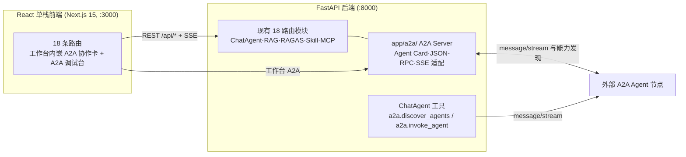

# PRism 重构技术方案（React 单栈 + A2A 后端）

> 状态：Phase N0/N1/N2 已完成，N3 联调回归进行中
> 项目落点：`f:\面试\PRism`（git 已初始化）
> 原则：功能纯增量，不大幅删除现有技术；验证以构建/静态检查 + 真机联调为准。

---

## 一、总体蓝图

大工作块：

1. **更名与落位**：全局 DevFlow AI → PRism AI（已完成）
2. **A2A 后端**（纯增量）：把现有 Agent 以 A2A 协议对外发布，并让 ChatAgent 可调用远端 A2A Agent（已完成并验证）
3. **React 工作台内嵌 A2A**：不新增页面，把多 Agent 协作真实呈现在对话流中，并保留一个协议调试台（已完成）

---

## 二、Phase N0：更名 PRism（已完成）

项目已迁至 `f:\面试\PRism`，命名统一（项目未产生持久数据，改动零成本）：

| 类别       | 文件                                 | 改动                                                                                                 |
| ---------- | ------------------------------------ | ---------------------------------------------------------------------------------------------------- |
| 后端应用名 | `backend/app/core/config.py`       | `app_name: "DevFlow AI"` → `"PRism AI"`                                                         |
| 环境变量   | `.env.example`                     | `APP_NAME=PRism AI`；`PROMPT_CACHE_KEY=prism-agent-v1`；`MILVUS_COLLECTION=prism_rag_qwen1024` |
| 容器与卷   | `docker-compose.yml`               | `container_name: prism-*`，卷名 `prism_*`（本地未跑过 Docker，安全）                             |
| 数据库     | `.env.example`                     | `DATABASE_URL` 中库/用户 `devflow` → `prism`；`scripts/init_pgvector.sql` 注释同步          |
| 前端包名   | `frontend/package.json`            | `devflow-ai-frontend` → `prism-react`                                                           |
| 页面标题   | `frontend/app/layout.tsx` metadata | `DevFlow AI` → `PRism AI`                                                                       |
| README     | `README.md`                        | 全文更名 + 新增 React 单栈架构与 A2A 章节                                                         |
| 文档       | `docs/` 内出现 DevFlow 字样的文件  | 同步更名                                                                                             |

**不动**：Python 包路径 `backend/app/...`、表名、API 路径 `/api/*`（避免大面积代码改动）；如需彻底改包名另行评估。

---

## 三、Phase N1：A2A 协议后端（已完成，零删除）

### 3.1 依赖与配置

- 新增依赖：`a2a-sdk`，锁定 `>=0.3,<0.4`（按安装版本对应的 spec 实现；要求 Python ≥3.10）
- `.env` 三行（默认关闭）：`A2A_ENABLED=false`、`A2A_PUBLIC_BASE_URL`、`A2A_TRUSTED_AGENTS`

### 3.2 新模块 `backend/app/a2a/`（六件套）

| 文件               | 职责                                                                                                                                                                                                                       |
| ------------------ | -------------------------------------------------------------------------------------------------------------------------------------------------------------------------------------------------------------------------- |
| `card.py`          | 构建 Agent Card：声明两个 Agent——`prism_chat`（ChatAgent）与 `prism_review`（WorkflowOrchestrator），含 skills/description/流式能力声明；发布于 `/a2a/.well-known/agent-card.json`                                          |
| `server.py`        | `A2AStarletteApplication` 挂载到 FastAPI `/a2a`（FastAPI 基于 Starlette，原生兼容）：JSON-RPC `message/send`、`message/stream`(SSE)、`tasks/get`、`tasks/cancel`                                               |
| `client.py`        | A2A 客户端：发现远端 Agent Card、发起 `message/send` / `message/stream`                                                                                                                                                      |
| `skills.py`        | 把现有 Agent 包装为 A2A Skill：入参 message/context → `ChatAgent.run_stream` / `WorkflowOrchestrator` 执行；产物 = `AnalysisResult` + citations                                                                     |
| `tools.py`         | 注册 `a2a.discover_agents`、`a2a.invoke_agent` 两个工具进 ChatAgent 现有工具表——对工具调用循环零改动，只是多两个工具                                                                                                        |
| `sse_adapter.py`   | **核心适配层**：现有 `run_stream` 事件（delta/tool_use/tool_result/final）→ A2A `TaskStatusUpdateEvent`；Task id/context id 关联与生命周期状态机（submitted→working→completed/failed）；citations → Artifact               |

### 3.3 接入点（均为增量）

1. **工作流远程执行**：`workflow_orchestrator._run_task_graph` 增加可选分支——任务 spec 声明 `executor: "a2a://<url>"` 时走远端 Agent，Observer/Synthesis 不动
2. **main.py**：`A2A_ENABLED=true` 时挂载 `/a2a` 路由（一个 if 分支）
3. **前端契约**：Agent Card 固定发布于 `/.well-known/agent-card.json`，供工作台 A2A 调试台拉取

### 3.4 测试与验证（新增，不动现有测试）

- `tests/test_a2a_agent_card.py`：Card 结构与 skills 声明
- `tests/test_a2a_stream_adapter.py`：run_stream 事件 → A2A 事件映射（含 final→completed、异常→failed）
- `tests/test_a2a_tools.py`：discover/invoke 工具的 mock 调用
- **现状**：`curl /a2a/.well-known/agent-card.json` 返回 200 合法卡片；全量 `pytest` **209 通过**；关掉开关后系统行为与现状一致

---

## 四、Phase N2：工作台内嵌 A2A（已完成）

不新增 `/agents` 路由，A2A 全部落在已有工作台 `frontend/app/page.tsx`：

| 区块 | 内容 | 落点 |
| ---- | ---- | ---- |
| 对话流协作卡 | 「A2A 小组」开关开启后，提问走 `POST /api/chat/plan` → `POST /api/chat/plan/execute/stream`，卡片展示规划任务、各领域 Agent 真实产出与状态、Observer 置信度与最终汇总 | `components/chat/a2a-discussion.tsx` |
| 历史一致性 | 后端在消息 meta 持久化 `a2a_group` 与 `agent_events`，历史接口回传，刷新/切会话后重建同一张卡片 | `app/api/routes/chat.py`、`app/schemas/chat.py` |
| A2A 协议调试台 | 工作台右侧「A2A」标签页：Agent Card、远端端点发现、`message/send`/`message/stream` 双通道、生命周期时间线、SSE 协议帧检查器 | `components/workspace/a2a-panel.tsx` |
| 协议客户端 | Agent Card 拉取、JSON-RPC 载荷构造、`data:` 流式帧解析（兼容 CRLF 分帧）、帧语义识别 | `lib/a2a.ts` |

**验收（已达成）**：工作台提问可见多 Agent 协作卡与真实 Agent 产出；A2A tab 拉取 Agent Card 并跑通流式任务；`tsc --noEmit` 与 `next build` 双绿。

---

## 五、Phase N3：联调与回归（进行中）

- 工作台 A2A 链路对本机 `/a2a` 联调：协作卡、双通道提交、时间线、协议帧全链路走通
- ChatAgent 工具验证：对话中让 Agent「调用远端 Agent 分析 X」，观察 `a2a.invoke_agent` 轨迹
- RAGAS 回归：跑一轮固定评测确认 Agent 行为无破坏

**验收**：pytest 209 保持通过；`tsc --noEmit` + `next build` 双绿。

---

## 六、实施顺序与里程碑

| 顺序 | Phase           | 交付物                                                                              | 状态  |
| ---- | --------------- | ----------------------------------------------------------------------------------- | ----- |
| 1    | N0 更名         | 全局 PRism 命名 + git 提交                                                          | ✓     |
| 2    | N1 A2A 后端     | `/a2a` 可用（curl 验证 agent-card + message/send + message/stream）+ 3 个测试文件  | ✓ 209 pytest |
| 3    | N2 工作台 A2A   | 对话流协作卡 + 历史重建 + A2A 协议调试台                                            | ✓     |
| 4    | N3 联调与回归   | 本机联调 + a2a.* 工具验证 + RAGAS 回归                                              | 进行中 |

## 七、风险与对策

1. **a2a-sdk 迭代快**：锁定 `>=0.3,<0.4`，按安装版本的 spec 写 card 与事件，`card.py` 集中隔离命名差异
2. **run_stream → A2A 事件语义**：A2A 要求 Task 生命周期与 id 关联，`sse_adapter.py` 是唯一设计难点，单文件封装 + 单测覆盖 delta/tool_use/final 三类事件
3. **CORS**：联调 `/a2a` 时核对后端白名单放行前端 dev 源的 Origin
4. **远端 Agent 不可达**：客户端超时与页面降级提示；`A2A_ENABLED=false` 时整体关闭，行为回退现状

---

## 八、总验收清单

- [x] 工作台「A2A 小组」提问可见多 Agent 协作卡与真实 Agent 产出
- [x] 右侧 A2A tab 可拉取 Agent Card、跑通 `message/stream`、查看生命周期与协议帧
- [x] 刷新/切换会话后协作卡样式与运行中一致
- [ ] 全量 `pytest` 保持通过
- [x] `tsc --noEmit` 与 `next build` 双绿
