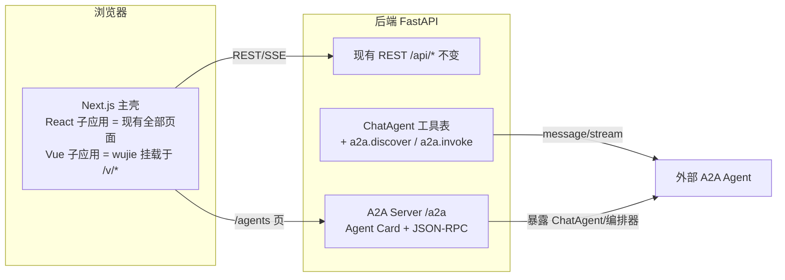

# PRism 双栈微前端 + A2A 重构方案

> 状态：**待审批**（本文档为实施方案，未经确认不动手）
> 目标读者：项目所有者
> 关联决策：前端长期保留 React/Vue 双栈切换；后端纯增量添加 A2A 协议

---

## 一、目标与原则

| 目标 | 说明 |
|---|---|
| 双栈长期共存 | React（Next.js 15）与 Vue 3 两套完整前端长期并存，一键切换对比，不是迁移期脚手架 |
| A2A 纯增量 | 后端以新增模块方式接入 Agent2Agent 协议，不删改任何现有路由/Agent/RAG/评测逻辑 |
| 可回退 | 每阶段独立可验收，任一阶段失败不影响已上线能力 |
| 面试叙事 | 微前端（wujie）+ 渐进式双栈 + A2A 多智能体协议 = 三层差异化考点 |

**明确不删除清单**（承诺不动）：
- 18 组 REST 路由、LangGraph 工具循环、Milvus RAG 管线、RAGAS 评测、Skill Runtime、MCP 记忆
- 32 张数据库表、docker-compose 结构（本地原生 PG 运行方式不变）
- React 版全部页面功能与 API 契约（`NEXT_PUBLIC_API_BASE_URL` 继续生效）

---

## 二、目标架构



- **React 栈**：现有 Next.js 应用，路由不变，作为主壳同时承载 wujie Vue 微前端
- **Vue 栈**：新增 `frontend-vue/`（Vite + Vue 3 + TS），以子应用形式挂载
- **切换开关**：顶栏 React/Vue 徽标按钮，同一路由在两套实现间跳转（`/repos` ↔ `/v/repos`）
- **A2A**：后端新增 `/a2a` 挂载点 + ChatAgent 两个新工具，对外可被任意 A2A 端点发现与调用

---

## 三、阶段划分

### Phase 0 — PRism 统一更名（半天粒度：小）

| 项 | 现值 | 改为 |
|---|---|---|
| `APP_NAME` (.env) | DevFlow AI | PRism |
| `layout.tsx` metadata | 已改 ✓ | — |
| `app-shell.tsx` 品牌区 | 已改 ✓ | — |
| package.json name | devflow-ai-frontend | prism-frontend |
| Milvus collection / prompt cache key | devflow_* | prism_* |
| README 标题 | DevFlow AI | PRism（附更名说明） |
| 数据库（可选，由你自行执行） | prism | 如需改名：`ALTER DATABASE prism RENAME TO 新名;` + `.env` 同步 |

**验收**：全局搜索 `devflow`/`DevFlow` 仅剩历史注释；`tsc --noEmit` 通过。

### Phase 1 — A2A 后端增量（核心新增）

新增 `backend/app/a2a/` 模块：

```
app/a2a/
├── card.py          # Agent Card 构建（ChatAgent、WorkflowOrchestrator 两个 skill）
├── server.py        # A2AStarletteApplication 挂载 /a2a（FastAPI 原生兼容）
├── skills.py        # 把 chat_agent.run / orchestrator 包装成 A2A AgentSkill
├── sse_adapter.py   # run_stream 事件(delta/tool_use/final) → TaskStatusUpdateEvent/Artifact
├── client.py        # A2A 客户端：发现远端 Agent Card、发起 message/send|stream
└── tools.py         # 注册 a2a.discover_agents / a2a.invoke_agent 两个工具进 ChatAgent
```

协议映射要点：
- Agent Card 发布于 `/.well-known/agent-card.json`（锁 a2a-sdk 版本，按对应 spec 命名）
- `message/stream` SSE ↔ 现有 `run_stream`：Task id/context id 关联，final 时产出 Artifact（复用 AnalysisResult + citations）
- WorkflowOrchestrator：任务 spec 新增可选 `executor: a2a://<agent-url>` 分支，Observer/Synthesis 不动
- `.env` 新增（全部默认关闭）：`A2A_ENABLED=false`、`A2A_PUBLIC_BASE_URL`、`A2A_TRUSTED_AGENTS`

**验收**：`A2A_ENABLED=true` 后 `curl /a2a/.well-known/agent-card.json` 返回合法卡片；用官方 a2a-cli 发送 `message/send` 收到 ChatAgent 兜底回答；关掉开关后系统行为与现状完全一致。

### Phase 2 — Vue 3 子应用（`frontend-vue/`）

技术栈：**Vite + Vue 3 + TypeScript + vue-router 4 + @tanstack/vue-query + Tailwind（复用同一份 tailwind.config）+ lucide-vue-next + markdown-it**。

页面迁移映射（React 版保持不动，Vue 版逐页实现）：

| React 路由 | Vue 路由 | 复杂度 |
|---|---|---|
| / | / | 高（5620 行拆 ~20 组件 + composables） |
| /repos | /repos | 中（332 行） |
| /issues /pull-requests /ci /workflow-runs | 同名 | 低-中 |
| /rag /knowledge | 同名 | 中（rag 414 行含上传） |
| /evals | /evals | 中（772 行轮询状态机） |
| /reports /action-drafts /workspaces /code-graph | 同名 | 低 |
| **/agents（新增）** | **/agents** | 中（A2A 目录 + 任务时间线，Vue 优先实现） |

**验收**：Vue 版 13 页均可独立于 React 版运行（直连后端 API），`vite build` 通过。

### Phase 3 — wujie 双栈集成

- 主壳（Next.js）以 client component 动态引入 `wujie-vue3`，`ssr:false`
- Vue 子应用独立构建（base=/v/，dev 端口 3010），主壳代理或直连
- 同步项：路由跳转同步（wujie `sync:true`）、样式隔离（shadowDOM）、CORS 白名单追加 3010
- 切换开关：顶栏左右角 React/Vue 徽标，点击跳转对应当前路由的另一栈实现

**验收**：`/repos`（React）与 `/v/repos`（Vue）展示同一份后端数据；切换按钮往返无损；`tsc`/`vite build` 双绿。

### Phase 4 — /agents 页与 A2A 联调

- Vue 版 `/agents`：拉取本机 Agent Card + 可配置远端端点列表、任务提交、生命周期时间线
- ChatAgent 工具验证：对话中让 Agent「调用远端 Agent 分析 X」，观察 a2a.invoke_agent 轨迹
- RAGAS 回归：跑一轮固定评测确认 Agent 行为无破坏

---

## 四、风险与对策

| 风险 | 对策 |
|---|---|
| a2a-sdk 版本变动快 | 锁定 minor 版本，card.py 集中隔离 spec 命名差异 |
| run_stream → A2A 事件语义差异 | sse_adapter 单文件适配器 + 单测覆盖三类事件 |
| page.tsx 拆分回归 | 先机械拆组件不改逻辑，Vue 化前后各跑一次 tsc + 手工核对关键流 |
| wujie 与 Next App Router 兼容 | 仅在 client component 中加载；如遇阻塞，备选方案 micro-app |
| 双栈内存状态不互通 | 已知限制：切换丢失内存态（聊天流/表单），URL 参数与后端数据无损；在 UI 上明示 |
| Watt Toolkit hosts 劫持 | 保持 GitHub 加速关闭；A2A 联调外部 Agent 时同样受影响 |

## 五、里程碑顺序与交付物

```
Phase 0 更名 → Phase 1 A2A 后端（可独立演示） → Phase 2 Vue 子应用（可独立演示）
→ Phase 3 wujie 双栈切换 → Phase 4 /agents 页 + 全链路联调
```

每阶段交付：代码 + 对应验收命令输出 + README 增量更新。

---

## 六、审批点

1. 双栈架构选型 **wujie**（备选 micro-app）是否认可？
2. Vue 子应用目录名 `frontend-vue/`、dev 端口 **3010** 是否认可？
3. Phase 1 先行的顺序是否认可（A2A 后端不依赖前端，可先行验证）？
4. 数据库改名是否随 Phase 0 一起做（由你自己执行 ALTER DATABASE）？

> 确认后按 Phase 0 → 1 顺序开工；每阶段完成即汇报，随时可叫停。
